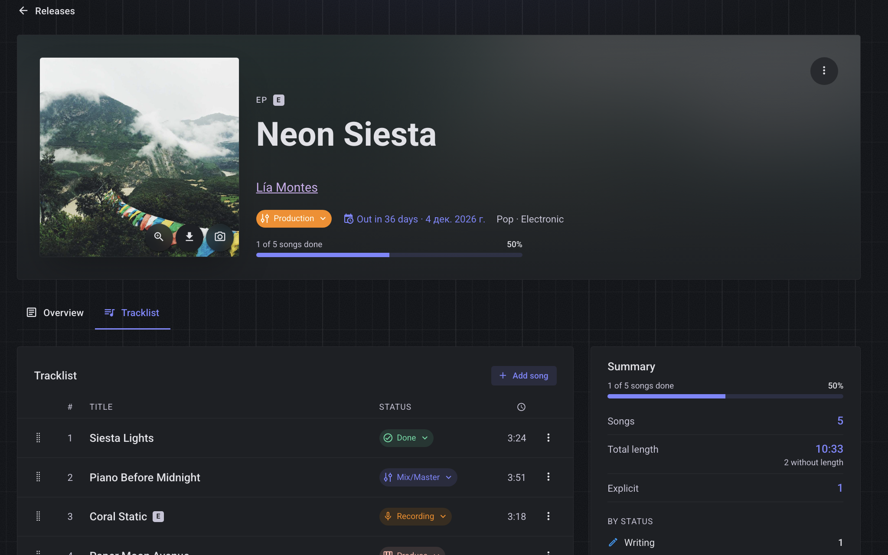

# Cadence — Music Release Planner · Frontend

🔗 **Frontend repo:** [cadence-frontend](https://github.com/danielmuntyanu/cadence-music-release-planner-frontend)
🔗 **Backend repo:** [cadence-backend](https://github.com/danielmuntyanu/cadence-music-release-planner-backend)

📖 **Documentation:** [Frontend wiki](https://github.com/danielmuntyanu/cadence-music-release-planner-frontend/wiki) · [Backend wiki](https://github.com/danielmuntyanu/cadence-music-release-planner-backend/wiki)

The web app for **Cadence** — a workspace where independent musicians manage every release, every track and every file in one place.



## Highlights

| | |
|---|---|
| 🎧 **Global player** | Plays a release in tracklist order or compares versions of a song; keeps playing across pages |
| ⬆️ **Direct uploads** | Masters up to 500 MB go straight to storage, with progress and cancel |
| ✏️ **Inline editing** | Edit any release field in place: Enter to save, Esc to cancel |
| ↕️ **Drag-and-drop tracklist** | Optimistic reordering with rollback on failure |
| 🔗 **Shareable filters** | Search, filters, sort and page are kept in the URL |
| 🔒 **No tokens in JavaScript** | HttpOnly cookies, silent refresh, CSRF header |
| 📱 **Responsive** | Separate layouts for phone, tablet and desktop |
| 🌗 **Two themes** | Studio Dark and Daylight |

## Tech Stack

| Area | Technology |
|---|---|
| Framework | Vue 3 (`<script setup>`) · Vite |
| UI | Vuetify 4 · Tailwind CSS 4 · Material Design Icons |
| State | Pinia |
| Routing | Vue Router |
| HTTP | Axios with auth and refresh interceptors |
| Drag and drop | vue-draggable-plus |
| Testing | Vitest · Vue Test Utils · jsdom · Playwright |
| Code quality | ESLint · Oxlint · Prettier |

## Architecture

```
views → components → stores / composables → services → api.js (axios) → REST API
                                               ↓
                                            models (DTO → app shape)
```

| Layer | Responsibility |
|---|---|
| `services/` | One function per endpoint, returns models |
| `models/` | Map and validate server data with safe defaults |
| `stores/` | Shared state: auth, artists, releases, player |
| `composables/` | Reusable logic: `useSubmit`, `useInlineEdit`, `useImageUpload` |
| `constants/` | Enums mirrored from the backend, with labels, colors, icons |
| `components/` | Feature folders: `artists`, `releases`, `songs`, `player`, `common`, `landing` |

More: [Architecture](https://github.com/danielmuntyanu/cadence-music-release-planner-frontend/wiki/Architecture) · [Features](https://github.com/danielmuntyanu/cadence-music-release-planner-frontend/wiki/Features) · [User Flow](https://github.com/danielmuntyanu/cadence-music-release-planner-frontend/wiki/User-Flow) · [Security](https://github.com/danielmuntyanu/cadence-music-release-planner-frontend/wiki/Security)

## Getting Started

Requires Node.js `^22.18.0` or `>=24.12.0` and the [backend](https://github.com/danielmuntyanu/cadence-music-release-planner-backend) running locally.

```bash
npm install
echo "VITE_API_URL=https://localhost:8443/api/v1" > .env.local
npm run dev
```

Open `https://localhost:5173`. Local HTTPS setup: [Get Started](https://github.com/danielmuntyanu/cadence-music-release-planner-frontend/wiki/Get-Started).

## Scripts

| Command | Does |
|---|---|
| `npm run dev` | Dev server with hot reload |
| `npm run build` | Production build |
| `npm run preview` | Preview the production build |
| `npm run test:unit` | Unit and component tests (Vitest) |
| `npx vitest run --coverage` | Coverage report in `coverage/` |
| `npm run test:e2e` | End-to-end tests (Playwright; run `npx playwright install` first) |
| `npm run lint` | Oxlint + ESLint |
| `npm run format` | Prettier |

## Testing

Models, utils, services, stores, composables, components and views are covered with Vitest and Vue Test Utils. Results: [Testing](https://github.com/danielmuntyanu/cadence-music-release-planner-frontend/wiki/Testing).

## Roadmap

| Status | Scope |
|---|---|
| ✅ | Landing page, auth, artists, releases, tracklist, audio files, global player |
| 🔜 | Tasks and key dates per release, calendar view |
| 🔜 | Pitching to playlists and press |
| 💡 | Reminders, collaborators, AI assistance |

## Author

**Daniel Muntyanu** — [GitHub](https://github.com/danielmuntyanu)
